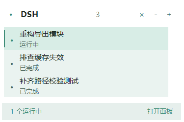

# dsh-session-clean

给 DeepSeek Harness 补上**批量删除会话**、**批量导出对话**、**会话隔离区**与**回合完成通知**：
进回收站、可还原、不改官方任何文件，入口分散在侧边栏底部、每个会话行、独立面板和设置页。

> DSH 自带归档（archive）与置顶（pin），但没有删除。归档只是把会话从列表摘掉并禁止再跑模型，
> 磁盘上的正文和缓存原封不动。本项目补的是「真的删掉，但删得回得来」，
> 外加「把要用的那几场对话单独抽出来」和「跑完了告诉我一声」。

## 能力一览

| 能力 | DSH 官方 | 本插件 |
|---|---|---|
| 归档 / 取消归档 / 置顶 | ✅ | 复用 |
| 物理删除（单条） | ❌ | ✅ 进回收站，可还原 |
| **物理删除（批量）** | ❌ | ✅ 侧边栏一键多选删除 |
| **导出对话（批量）** | ❌ | ✅ Markdown / JSON / 两者，落盘或 ZIP 下载 |
| 回收站还原 | ❌ | ✅ **还原同时取消归档**（否则侧边栏不显示） |
| **会话隔离区**（把当前对话单独放一边） | ❌ | ✅ 一键抽出、一键放回原位 |
| **会话桌面**（把常用对话钉到常驻浮条，一点切换） | ❌ | ✅ 最多 12 个，可折叠 |
| **每个会话的侧边栏入口** | 仅归档 / 置顶 / 重命名 / 分叉 | ✅ 菜单 + 悬停按钮 |
| **回合完成通知**（类 GPT） | Electron 原生（仅桌面、仅窗口失焦） | ✅ 面板内 toast + 系统通知，点击直达会话 |
| 检索（标题 / ID / 目录） | 侧边栏搜索 | ✅ 面板内即时筛选 |

## 界面

五个入口，全部走官方插槽，**不覆盖、不修改任何官方组件**：

| 入口 | 插槽 | id / key | order |
|---|---|---|---|
| 侧边栏底部按钮 | `sidebar.footer.action` | `session-clean.toggle` | 40 |
| 会话管理浮层 | `shell.overlay` | `session-clean.panel` | 60 |
| 设置页分区 | `settings.section` | `session-clean.trash` | 900 |
| 会话行「...」菜单 | `sidebar.workspaces.session.menu.item` | `session-clean.stash` / `session-clean.trash` | 500 / 510 |
| 会话行悬停按钮 | `sidebar.workspaces.session.row.action` | `session-clean.stash-row` | 300 |
| 隔离区面板 | `main`（keyed）+ `sidebar.panellist` | `session-clean.stash` | 20 |

侧边栏按钮点开后是**会话跳板**（不是只有批量删除）：



- **点一行就打开那个对话**，并关闭面板 —— 会话多了之后，这是最快的切换方式；
- 搜索框是**白色流光圆角边框**：四层 conic 渐变（`glow / dark / white / border`）用白色弧线
  各自以不同相位 7–13s 慢速旋转，hover / 聚焦时加速到 2.4–3.6s；内层另有一条
  `inset 0 0 0 1px rgba(255,255,255,.2)` 的静态白边打底，所以静止时也是清晰的白框；
  左侧放大镜、右侧白色描边的漏斗小方钮；`prefers-reduced-motion` 下停转；
- 每行前面的勾选用的是**原样搬过来的 SVG 勾选组件**：`input + label.terms-label` 兄弟结构，
  `#8c00ff` 描边（`stroke-width` 24 / `rx` 56 的柔角空心框，无填充），勾用
  `stroke-dasharray/dashoffset` 的 0.55s 绘制动画；类名与原作者 CSS 一致，只在 `.sc-row` 作用域内生效。
- 搜索框自动聚焦，输入标题 / 目录 / 会话 ID 即时过滤（本地筛，不往返服务端）；
- `↑` `↓` 移动高亮、`Enter` 打开、`Esc` 关闭；面板外按 **Alt+K** 随时唤出；
- 已归档 / 隔离中的会话也在列表里，点开会**先自动放回再打开**，不会卡在「归档不可打开」；
- 每行右侧：打开 / 隔离（放回）/ 勾选（批量删除、导出仍保留在底部）。

批量那套仍然在跳板里（勾选后才启用）：

- **多选** —— 每行复选框 + 「全选」「取消选择」；配对不全（正文或缓存缺一）的会话不给勾；
- **删除选中** —— 两段式：先变「确认删除 N 个？」，再点才执行，防误触；
- **导出** —— 格式 Markdown / JSON / 两者：「导出到磁盘」落 `<DSH_HOME>/exports/<时间戳>/`，
  「下载 ZIP」打成一个包含全部选中会话 + `index.md` 的包直接下载；
- **回收站** Tab —— 还原 / 彻底删除 / 清空，和设置页是同一个组件。

### 会话行入口：为什么以前注册不上、现在可以了

`sidebar.workspaces.session.menu.item` / `sidebar.workspaces.session.row.action` 是
**`sidebar.workspaces` 的子表插槽**（父条目在 `children` 里声明），所以 `apply()` 执行时
它们还没被 declared。直接 `ctx.slots.register` 会抛：

```
slot "sidebar.workspaces.session.menu.item" is not declared
(a parent entry's children table must declare it)
```

正确做法不是绕开它，而是**等声明**：

```js
ctx.slots.inject('sidebar.workspaces.session.menu.item', () => {
  ctx.slots.register({ name: 'sidebar.workspaces.session.menu.item', id: '...', order: 500, locale: NS }, Comp);
});
```

槽位拥有者（ui-workspace）自己的 `pin` / `rename` / `fork` / `archive` 就是这么注册的，
插件用同一套写法即可；条目按 `order` 落在官方动作之间，`useMenuOpenState` 由宿主的
hookContext 自动注入，`MenuItemButton` 从 `@deepseek-ai/dsh-client-ui-primitives` 取（拿不到就退化成
原生 `role="menuitem"` 按钮）。

`sidebar.footer.action` 是会话跳板的入口（Alt+K 同效）；每行菜单/悬停按钮适合「就现在这一场对话」。

## 开机自启

```powershell
# 看状态 / 开 / 关（当前用户，HKCU Run，随时可删）
powershell -ExecutionPolicy Bypass -File scripts\autostart.ps1 status
powershell -ExecutionPolicy Bypass -File scripts\autostart.ps1 on
powershell -ExecutionPolicy Bypass -File scripts\autostart.ps1 off
```

只写一个用户级注册表值 `HKCU\Software\Microsoft\Windows\CurrentVersion\Run`
（值名 `DeepSeek Harness`，数据是带引号的 exe 全路径），不碰应用文件。
DSH 自身没有登录项开关，也没有 `--hidden` 参数，所以是登录后正常启动窗口。

## 还原为什么必须「取消归档」

DSH 的归档**不是文件操作**，而是往注册表里塞一个 id：

```jsonc
// $DSH_HOME/storages/workspace.json
{
  "global": { "archivedSessionIds": ["session-xxxx", ...] },
  "tables": { "workspaces": { "<wsId>": { "sessionIds": ["session-xxxx"] } } }
}
```

侧边栏渲染时先按这个集合过滤，再按 `sessionIds` 排序展示。
于是「把正文和缓存搬回原处」只满足了可见条件的一半 —— 集合里还留着这个 id，
这一行就还是不出现（**这就是之前「还原了但侧边栏没有」的根因**）。

现在的还原是三步：

1. `restoreBatch()` 按 manifest 反向 rename 搬回文件；
2. `workspaceRegistry.unarchiveSession(id)`（进程内）或直接改 `archivedSessionIds`（CLI）摘掉归档；
3. 客户端调 `sessions.refresh()` 重建列表基线，侧边栏立刻长出这一行。

归档时不动 `sessionIds`（官方行为），所以「放回」能回到**原来的工作区位置**，不用重新分组。

## 隔离区（把正在用的对话单独放一边）

## 桌面（钉住的会话）：工具箱 → 桌面

会话一多，侧边栏就是「工具箱」：每次都要翻。**桌面**是另一份清单：

- 会话行「...」菜单 → **放到桌面**；跳板每行的 **☆** 也是它；跳板里勾选多行后点
  **放到桌面（N）** 可以一次批量放上去；
- 左下角立刻多出一张常驻小卡片，列出这几个对话：点一下**直接切过去**，`×` 收回；
- 桌面项上有状态点：蓝色表示这一轮正在跑；当前打开的那条高亮；
- `+` 打开会话跳板继续挑，`–` 把桌面收成一个小图标（不占地方）；
- **拖动头部可以把它挪到任意位置**（位置存在 `localStorage: session-clean.desk.pos`），
  双击头部回到默认位置；
- 头部 `↑` / `↓` 切换层级：**置顶**（盖在内容上）或**置底**（z-index 1，落在内容下面，
  只在空白处露出）—— 存 `session-clean.desk.z`；
- 桌面为空时只剩一个很小的「📌 桌面」入口。

和官方 `pin` / 归档的区别：

| | 作用 |
|---|---|
| 官方 `pin` | 只是列表排序靠前，仍然在工具箱里 |
| 官方归档 | 把行藏起来（要放回才能打开） |
| **桌面** | 额外的常驻快捷入口；会话本身不动、不归档、不改顺序，只是随手就能点 |

桌面清单存在浏览器 `localStorage: session-clean.desk`，最多 12 个，刷新/重启都在。
点桌面项时若那条会话是归档的，会先自动放回再打开。

### 最小化之后也要能用：系统置顶小窗

应用内浮条跟着 DSH 窗口走，最小化就看不见了。所以另有一个**独立置顶小窗**
（`scripts/desk-window.ps1` + 无控制台启动器 `desk-window.vbs`），
外观**照抄应用内浮条**：238 宽的深色卡片、1px 细边、12px 圆角、每行一个状态点、
悬停高亮、右上 `+`（唤起 DSH）/ `-`（折叠）。


- 无边框、置顶、不占任务栏；拖头部移动、双击折叠、右键 `刷新 / 深色 / 浅色 / 退出`；
- 点条目 → 让 DSH 窗口恢复前台 + 切到那个对话；点 `×` → 从桌面收回；
- 单实例（命名互斥体），重复启动直接退出；
- 数据链路：客户端把清单 `POST /session-clean/desk-state` → 宿主镜像 →
  小窗 2s 轮询；小窗点击 `POST /session-clean/desk-open` → 宿主入队 →
  客户端 1.2s 轮询 `/desk-pending` 并执行（打开 / 收回）；
- 端口发现走 `$DSH_HOME/session-clean/desk.json`（宿主每次启动写入，含当前 web 端口）；
- 位置与主题存在 `$DSH_HOME/session-clean/desk-window.json`；
- 开发用：`desk-window.ps1 -Snapshot out.png` 渲染一张静态图就退出（用来对样式）。

> **PowerShell 事件闭包坑**：`Add_*({ ... })` 的回调在函数返回后才触发，此时
> `Add-Row` 里的局部变量（`$row` / `$dot` / `$del`）已经没了，写 `$row.BackColor`
> 会变成给 `$null` 赋属性而抛 `在此对象上找不到属性"BackColor"`（表现为 JIT 调试
> 对话框）。所以回调用 `$sender` 反查父级行、用 `.GetNewClosure()` 固定需要的变量，
> 行状态存进 `Tag` 的哈希表（`@{ id; active }`）而不是直接塞字符串。

为什么不让插件自己开窗：宿主是 `DeepSeek Harness.exe --expose-internals .../dsh-desktop-host`
的**子进程**（ELECTRON_RUN_AS_NODE），`require('electron')` 不可用（`/session-clean/probe`
可现场验证），所以置顶窗口只能由外部进程持有。

启动 / 退出：

```powershell
wscript.exe scripts\desk-window.vbs          # 启动（无控制台）
# 退出：小窗上右键 → Exit
```

可选：让它跟着开机启动（DSH 没跑时显示 `DSH not running`，可右键 Exit）：

```powershell
$run = "HKCU:\Software\Microsoft\Windows\CurrentVersion\Run"
Set-ItemProperty $run -Name "DeepSeek Harness Desk" `
  -Value '"C:\Windows\System32\wscript.exe" "D:\path\to\scripts\desk-window.vbs"'
```


侧边栏面板列表里的「隔离区」是独立的一屏（`main` keyed 槽位 + `sidebar.panellist` 图标）：

- **隔离当前对话** —— 自己解析主视图里的会话 id，不用先在列表里找；
- **放回** —— 每行一个按钮，取消归档 + 清台账，会话回到原工作区原位置；
- 行菜单 / 悬停按钮也能对任意一条会话做同样的事。

「隔离」= 官方归档 + 台账记账。台账在 `$DSH_HOME/session-clean/stash.json`，
只是用来把「插件抽出来的」和「用户自己归档的」分开，丢了也不影响会话本身。

为什么不是「挪到另一个工作区」：DSH 的会话归属由**记录目录（header.cwd）**决定，
一个会话只能属于路径匹配的那个工作区，官方没有「换工作区」的 API。所以这里实现的是
**可见性隔离**：会话从侧边栏消失、集中到隔离区、原位置原样保留。

## 修复：看不见的会话（历史遗留）

旧版本「还原」只搬文件、不摘归档集合，于是有些会话变成：正文和缓存都在磁盘上、
侧边栏里却没有、回收站里也没有。设置页 → 会话管理 → **修复：看不见的会话**：

1. 「检查」→ 列出「在归档集合里、但文件齐全」的会话（只读，不改任何东西）；
2. 逐行「放回」或「全部放回」→ 取消归档 + `sessions.refresh()`。

不自动执行：你**主动归档**的会话也在同一份集合里，所以这一步要你点一下。

## 回合完成通知（类 GPT）

客户端**只读** `sessions.list` 快照：某个会话的 `running` 由 `true` 变 `false`，就是一轮跑完。

- 面板内 toast：右下角一条，点一下直接打开那个会话；
- 系统通知：仅当窗口不在前台时发（前台只留 toast，避免双份），需要 `Notification` 权限；
- 总开关在 **设置 → 会话管理 → 任务完成通知**，状态存 `localStorage: session-clean.notify`；
- 同一处可以「申请系统通知权限」「发一条测试通知」。

与桌面端内置通知的关系：DSH 桌面主进程本来就有一条原生通知链路（`turn-completed` /
`turn-failed` / 定时任务），但它只在 Electron 窗口失焦时触发，且只存在于桌面端。
本插件的通知在渲染侧，Web 端同样有效；如果两边都开着又觉得重复，
关掉其中一个即可（本插件在设置页有开关，桌面那条在桌面偏好里）。

## 一个会话落在两处

```
$DSH_HOME/
├── sessions/<工作区目录>/<sessionId>/session.v4.jsonl.zstd   正文
└── storages/session_projcache/sessions/<sessionId>.json      投影缓存（标题在这里）
```

**两处必须一起处理**，否则删了正文列表还剩空标题、删了缓存正文变孤儿。
插件只删除「两处都能找到」的会话；缺一处就报 `incomplete` 并跳过，不猜。

## 正文是多帧 zstd，不是单帧

`session.v4.jsonl.zstd` 是**帧拼接容器**：header 一帧，之后每个 append 批次一帧。
`zlib.zstdDecompressSync()` / `createZstdDecompress()` **只解第一帧**，
直接拿去读整份日志只会得到 header 那一行 —— 表现为「会话明明有内容，扫出来是空」。

所以 `lib/zstd-log.js` 先按帧结构切边界（magic + frame header descriptor + block header 逐个走），
再逐帧解压拼接。切帧逻辑与 `@deepseek-ai/dsh-session-persistence-jsonl` 的 `scanZstdFrames` 同构：
不能靠搜索 `28 B5 2F FD` 切，因为该字节序列可能出现在压缩数据内部。

## 导出格式

单个会话 → 一个文件：

- **Markdown** —— 表头（会话 ID / 工作目录 / 创建时间 / 大小 / 轮次）+ 逐轮转录：
  用户输入、助手正文、`🔧 工具名 + 参数摘要`、`📄 工具结果`。
  默认过滤 `runtime-context` 与 `system-reminder` 这类注入消息，也不导出 `reasoning`（可用参数打开）。
- **JSON** —— 无损：`{ sessionId, title, workspace, header, events[] }`，事件原样。
- **both** —— 两个都要。

外加一个 `index.md`：全部会话的标题 / 时间 / 轮次 / 大小 / 文件链接 + 「开场白速览」。

ZIP 是自写的 store 模式打包（`lib/zip.js`，不引依赖），文件名按 UTF-8 标记，中文标题不乱码。

## 安全设计

| 风险 | 做法 |
|---|---|
| 把客户端搞崩 | **不改官方任何文件**；所有入口 `try/catch`，失败只记日志不 throw |
| 误删正在使用的会话 | 有 `workspaceRegistry` 时先调官方 `archiveSession`，它的 `session-active` 会拦下带任务的会话 |
| 误触批量删除 | 两段式确认（先 arm 再执行）；只勾得动「两处齐全」的会话 |
| 删了救不回 | 全程 `rename` 到回收站，只有 `purge` 才真删 |
| 还原时覆盖新数据 | 目标已存在且内容不同 → 报冲突，保留批次不覆盖；内容相同 → 视为已还原（幂等） |
| 只还原了一半 | 逐项独立处理，失败的不影响成功的；重写 manifest 只留剩余项，可再次 `restore` |
| 还原了但侧边栏不显示 | 还原 = 搬文件 + **取消归档** + `sessions.refresh()`；`test/stash.mjs` 专门盯这两步 |
| 误抽到隔离区 | 台账 + 归档集合各自独立，任意一边都能放回；会话文件全程不动 |
| 通知打扰 | 只读会话快照；总开关 + 系统通知权限分开，前台只留一条 toast |
| 删到一半中断 | 任一步失败整体回滚本次移动，不留半残批次 |
| 导出把会话搞坏 | 导出是纯读：`rename` 之外不碰会话文件，读不出就 `skipped`，不影响其他会话 |

### 崩溃防护

界面代码按「宿主崩了就是事故」的标准写：

- `ctx` 不合法、缺 `effect` → 入口直接 return；
- 缺 `slots` / `react` → 逐项降级，缺什么跳什么；
- **不裸访问 `ctx.locale` / `ctx.workspace` / `ctx.remote`** —— cordis 严格注入，直接访问会抛；
- 每个组件内部 `try/catch`；插槽注册包在 `ctx.effect` 里，卸载自动注销且可重复调用；
- `inBrowser` 在 factory 执行时判定一次，非浏览器侧直接退场。

## 用法

### 界面

侧边栏底部「🗂 / 会话管理」→ 勾选 → 删除选中 / 导出到磁盘 / 下载 ZIP。
设置 → 会话管理里也能做同样的事，并管理回收站。

### CLI

```sh
cd dsh-session-clean

# 只读：看有哪些会话、是否配对齐全
node bin/session-clean.js list
node bin/session-clean.js list --incomplete

# 删除（进回收站，可还原；支持一次多个）
node bin/session-clean.js delete session-xxxx session-yyyy

# 导出（Markdown / JSON / 两者）
node bin/session-clean.js export session-xxxx --format both
node bin/session-clean.js export --all --q 你好 --format md --out D:/dsh-exports

# 回收站
node bin/session-clean.js trash
node bin/session-clean.js restore <batchId>     # 还原一个批次（同时取消归档）
node bin/session-clean.js restore --all         # 全部还原
node bin/session-clean.js purge   <batchId>     # 彻底删除（不可恢复）
node bin/session-clean.js purge   --all         # 清空回收站

# 隔离区
node bin/session-clean.js stash   <sessionId>   # 抽进隔离区（= 归档 + 记账）
node bin/session-clean.js unstash <sessionId>   # 放回（= 取消归档）
node bin/session-clean.js stash-list            # 看隔离区里有什么
```

`--home <path>` 指定其他 `DSH_HOME`，默认 `$DSH_HOME` 或 `~/.dsh`。

> **CLI delete 前请退出 DSH 客户端**。会话正文有写入锁（LEASE），客户端运行时 `rename` 会 `EBUSY`。
> 插件会报错并回滚，不会损坏数据，但删不掉。界面里的删除走进程内 `archiveSession`，没有这个限制。

### HTTP 路由（界面在用，也可脚本直调）

| 方法 | 路径 | 说明 |
|---|---|---|
| GET | `/session-clean/sessions?q=&limit=&includeArchived=` | 会话列表（带 `archived` / `stashed`） |
| POST | `/session-clean/delete` | `{sessionId}` 删一个 |
| POST | `/session-clean/delete-many` | `{ids[]}` 批量删，返回 `deleted` / `failed[]` |
| POST | `/session-clean/export` | `{ids[],format}` 落盘，返回 `dir` / `files[]` |
| POST | `/session-clean/export-zip` | `{ids[],format}` 返回 `application/zip` |
| GET | `/session-clean/trash` | 回收站批次 |
| POST | `/session-clean/restore` | `{batchId}` 还原 **并取消归档**（返回 `unarchived` / `needRefresh`） |
| POST | `/session-clean/purge` / `purge-all` | 回收站清理 |
| GET | `/session-clean/stash` | 隔离区台账（带 `archived` / `onDisk`） |
| POST | `/session-clean/stash` | `{sessionId,title,stopActivity}` 抽进隔离区 |
| POST | `/session-clean/unstash` | `{sessionId}` 放回（取消归档 + 清台账） |
| POST | `/session-clean/archive` / `unarchive` | 只归档 / 只取消归档（不记台账） |
| POST | `/session-clean/stash-clear` | 清空台账（不动归档集合，也不动文件） |
| GET | `/session-clean/archived-hidden` | 只读：被归档但文件还在的会话 |
| POST | `/session-clean/repair-archived` | `{ids?}` 放回（不传 ids = 全部候选） |
| POST | `/session-clean/prompt-diag` | 只读诊断，不改任何内容 |

## 目录与回收站结构

```
$DSH_HOME/trash-sessions/
└── 20261030-131900-123-session-a5231cae/
    ├── manifest.json        # 原始路径、标题、时间、字节数
    ├── 01-session-session-a5231cae.../
    └── 02-cache-session-a5231cae.json

$DSH_HOME/exports/
└── 20261107-165133/
    ├── index.md
    ├── 20261105-1959-你好-1774fa80.md
    └── 20261105-1959-你好-1774fa80.json

$DSH_HOME/session-clean/
└── stash.json          # 隔离区台账（只记 id/标题/时间，不碰会话文件）
```

`manifest.json` 记着 `originalPath`，还原就是按它反向 `rename`，不猜不重建。
整个 `trash-sessions/` 或 `exports/` 目录可以直接删。

## 测试

```sh
node test/roundtrip.mjs        # 36 项：扫描 / 删除 / 回收站 / 还原 / 回滚 / 幂等
node test/client.mjs           # 28 项：假 ctx 下的插槽注册、图标/菜单/面板渲染容错
node test/client-parse.mjs     # 浏览器非模块编译（无顶层 export）
node test/export.mjs           # 11 项：多帧 zstd / Markdown / JSON / 落盘 / ZIP
node test/stash.mjs            # 10 项：归档集合 / 台账 / 隔离 / 还原取消归档 / registry 优先
node test/http.mjs             # 7 项：假 webServer 接住路由，端到端打 stash/unstash/restore/repair
node test/render.mjs           # 12 项：借 React 真 hooks 跑每个组件的函数体，抓「面板一打开就白屏」
```

全部只碰临时目录，不读真实会话内容。

## 开发：这个包在 profile 里是怎么接进来的

profile 的 `package.json` 里是 `"dsh-session-clean": "file:<本目录>"`；pnpm 默认按
**injectedDeps** 把它复制进 `~/.dsh/profiles/desktop/node_modules/`，于是改了源码、
宿主还在跑旧副本 —— 这是「改了没反应」的常见原因。

现在该目录是一个 **junction**，直接指向本目录：

```cmd
mklink /J "%USERPROFILE%\.dsh\profiles\desktop\node_modules\dsh-session-clean" ^
         "%USERPROFILE%\Documents\deepseek-harness\default-workspace\dsh-session-clean"
```

- 宿主半（`lib/*.js`）在插件条目上会随 Loader 重新加载；最省事的做法是
  **设置 → 插件**里把它关掉再打开，或重启 DSH；
- 客户端半（`client.js`）由宿主在启动/重载时快照，改完要**刷新页面**；
- 如果哪天 `pnpm install` 把 junction 换回了复制目录，删掉再重建即可
  （`node_modules/dsh-session-clean.bak-*` 是当时留的备份）。

## 边界

- 不提供「删除工作区」——只删会话存档，工作区注册表不动。
- **不搬工作区**：会话归属由记录的目录决定，官方没有换工作区的 API；「隔离区」是可见性隔离
  （从侧边栏摘掉、集中到独立一屏），原工作区位置原样保留，所以放回是原位置。
- 进程内优先用官方 `workspaceRegistry`；只有拿不到它（CLI 模式）才直接改 `workspace.json`，
  那时必须让 DSH 客户端退出，否则宿主内存里的注册表会覆盖文件改动。
- 导出的是**存档内容**（事件流），不是聊天界面的最终渲染结果（工具卡片、附件预览等不还原）。
- 会话正文有写入锁时删除会失败并回滚（CLI 模式），界面模式走 `archiveSession` 先摘列表。

---

# 文件清单与配置详解（DIY 用）

这一节是给"想改代码的人"看的：每个文件负责什么、哪些值可以安全调整、改了之后从哪里生效。

## 1. 目录结构

```
dsh-session-clean/
├── package.json          插件清单（DSH 靠它找到 host/client 入口）
├── cordis.patch.yml      DSH 装载时的注入点声明
├── lib/                  宿主半（Node，跑在 DSH 的 host 子进程）
│   ├── index.js          插件入口：注册 HTTP 路由、归档/取消归档、桌面协作
│   ├── store.js          扫描会话落点、配对校验
│   ├── trash.js          回收站（移入/列出/还原/彻底删除）
│   ├── export.js         导出 Markdown / JSON / ZIP
│   ├── transcript.js     事件流转录（把 jsonl.zstd 变成可读文本）
│   ├── zip.js            无依赖 ZIP 打包
│   ├── zstd-log.js       多帧 zstd 逐帧解压
│   ├── workspace-state.js 直接读写 storages/workspace.json
│   ├── stash.js          隔离区台账
│   └── prompt-diagnostics.js 只读诊断
├── bin/
│   ├── session-clean.js  CLI 入口（list/delete/export/trash/restore/stash…）
│   └── prompt-diag.js    诊断 CLI
├── client.js             客户端半（浏览器模块，150KB，全部 UI 都在这）
├── scripts/
│   ├── desk-window.ps1   外部置顶浮窗（WinForms）
│   ├── desk-window.vbs   无控制台启动器
│   ├── desk-ctl.ps1      浮窗开关（start/stop/restart/toggle/status）
│   └── autostart.ps1     开机自启开关
├── test/                 10 套测试，全部用临时目录，不碰真实数据
├── docs/                 架构说明与截图
└── README.md
```

## 2. 每个文件的"可调项"

### `cordis.patch.yml`
DSH 装载插件时读它，声明 host 入口与 client 入口。一般不用动。

### `package.json`
| 字段 | 作用 | 能不能改 |
|---|---|---|
| `dsh.bundle.patch` | 指向 `cordis.patch.yml` | 改文件名时同步改 |
| `dsh.client.platform` | 固定 `web` | 不要改 |
| `dsh.client.inject` | 客户端插槽声明（空数组表示由 `client.js` 自己 `slots.inject`） | 不要改 |
| `exports["./client"]` | 客户端模块入口 | 改文件名时同步改 |
| `engines.node` | `>=18` | 提高下限可以，降低未验证 |

### `lib/index.js`（宿主入口，约 1100 行）
- **路由表**：`const routes = [ ['/session-clean/xxx', handler], ... ]`，加接口就加一行；所有 handler 都经过 `guarded` 包装做同源检查。
- **`isSameOrigin(req)`**：跨站写请求拦截。想放开（不推荐）就改这里。
- **`ensureThemeLoaded()`**：主题懒加载，宿主重启后从 `theme.json` 补回。
- **`deskWatch`**：浮窗看门狗（心跳超时自动重启、连续 3 次失败熔断）。
- **`runDeskCtl(action)`**：调用 `scripts/desk-ctl.ps1`，改浮窗开关行为从这里入手。

### `lib/trash.js`（回收站）
- `TRASH_DIRNAME = 'trash-sessions'` —— 回收站目录名。
- `safeSegment(name)` / `slugify(name)` —— **路径安全的关键**。所有来自请求的 `batchId`、`sessionId` 都必须先过这里才能拼路径。
- `moveToTrash` 用 `fs.renameSync`（同卷原子）；跨卷才回退 `copyThenRemove`。

### `lib/export.js`（导出）
- `EXPORTS_DIRNAME = 'exports'` —— 默认导出目录。
- `exportToDisk(dshHome, records, { format, dir, allowOutside })`：
  - `dir` 默认只允许落在 `$DSH_HOME/exports` 之内；
  - CLI 传 `allowOutside: true` 才能写到任意位置；
  - **不要**给 HTTP 路由传这个开关（否则等于开放任意目录写入）。

### `lib/zstd-log.js`
多帧 zstd 切帧解压。DSH 的 `session.v4.jsonl.zstd` 是多个独立 frame 拼接，单帧 API 只能解出第一帧，所以这里按 magic number 切分逐帧解。改这里要准备多帧样本回归 `test/export.mjs`。

### `client.js`（客户端，单文件）
按顺序分四块，改 UI 只动前两块：

1. **主题层**（`THEMES` / `applyThemePrefs` / `setThemePrefs`）
   - 三套预设：`fog`（雾蓝灰紫）、`mint`（青灰薄荷）、`rose`（暖灰玫瑰），每套有 `dark` / `light`。
   - 想加配色：在 `THEMES` 里加一个 key，键名必须覆盖 `bg/surface/surface2/hover/active/text/dim/acc/acc2/border/border-strong/glow/focus/ok/warn/err/shadow`。
   - `themePrefs` 字段：`preset` `mode` `motion` `density` `windowTitle`。
2. **CSS 数组**（`var CSS = [...]`）
   - 所有 `.sc-*` 类都在这里，用 CSS 变量（`var(--sc-acc)`）取色。
   - **不要写死颜色**，否则切主题不跟随。
3. **组件与槽位**（`SidebarButton` / `SessionPanel` / `SessionsPane` / `StashPanel` / `SettingsSection`）
   - 每个组件都要 `try/catch` 包裹注册，插件崩溃不能拖垮宿主。
4. **桌面协作**（`deskItems` / `deskPayload` / `pushDeskNow` / `startDeskBridge`）
   - `deskPayload()` 决定推给浮窗的字段（`sessionId/title/running/current`）。
   - `startDeskBridge()` 里的 `setInterval(poll, 100)` 是长轮询接力间隔。

### `scripts/desk-window.ps1`（浮窗，约 1200 行）
关键常量集中在文件前 200 行：

| 变量 | 作用 | 调整效果 |
|---|---|---|
| `$global:W = 300` | 逻辑宽度 | 窗口变宽/窄 |
| `$global:ROW_H = 38` / `ROW_H_C = 28` | 舒适/紧凑行高 | 列表密度 |
| `$global:themeStamp` / `localCurrentId` | 同步用的临时状态 | 不要手动改 |
| `Set-Palette` | 把 theme.json 的 palette 映射成 `Color` | 想换默认色改这里 |
| `Apply-DwmFrame` | Win11 原生圆角 + 边框 | 想自绘边框就让它返回失败 |
| `Max-Rows = 7` | 列表最多显示几行 | 超出部分在 footer 提示 |

**DPI 策略**：`SetProcessDpiAwarenessContext(-4)` + `GetDpiForMonitor` 取真实 DPI + `AutoScaleMode = None`，三者缺一就会二次缩放（糊）。

### `scripts/desk-ctl.ps1`
`start|stop|restart|toggle|status`，输出 JSON。宿主与设置页都调它。

### `scripts/autostart.ps1`
只动 `HKCU\Software\Microsoft\Windows\CurrentVersion\Run`，两个值：`DeepSeek Harness`、`DeepSeek Harness Desk`。`status` 可随时查看。

## 3. 运行期数据（都在 `$DSH_HOME` 下，不在仓库里）

默认 `$DSH_HOME` = `%USERPROFILE%\.dsh`

| 路径 | 内容 | 能删吗 |
|---|---|---|
| `session-clean/desk.json` | 端口发现（`{port, pid, updatedAt}`） | 能，下次启动重建 |
| `session-clean/desk-window.json` | 浮窗位置/标题/密度/动效/置顶 | 能，回到默认位置 |
| `session-clean/theme.json` | 主题 token（客户端上报的完整 palette） | 能，客户端下次上报重建 |
| `session-clean/stash.json` | 隔离区台账 | **别删**，删了隔离区列表就空了 |
| `session-clean/desk-heartbeat.txt` | 心跳（看门狗用） | 能 |
| `session-clean/desk-desired.json` | 期望状态 `running/stopped` | 能，默认按 running |
| `session-clean/desk-run.log` | 启动/状态日志（**不含对话内容**） | 能 |
| `session-clean/desk-window-error.log` | 浮窗未捕获异常 | 能 |
| `trash-sessions/<batchId>/` | 回收站批次（含 `manifest.json`） | 等于彻底删除 |
| `exports/` | 默认导出目录 | 能 |

浏览器侧（`localStorage`）：
| 键 | 内容 |
|---|---|
| `session-clean.theme` | `{preset, mode, motion, density, windowTitle}` |
| `session-clean.desk` | 桌面会话 `[{sessionId, title}]`（**权威源**） |
| `session-clean.notify` | 通知开关 |

## 4. 数据流与权威性

```
用户点 ★  →  localStorage[session-clean.desk]（唯一权威）
                    │ POST /desk-state
                    ▼
            宿主内存 deskMirror  ←── GET ── 外部浮窗（不持久化列表）
```

- **会话内容**：`$DSH_HOME/sessions/<工作区>/<sessionId>/session.v4.jsonl.zstd`
- **投影缓存**：`$DSH_HOME/storages/session_projcache/sessions/<sessionId>.json`
- 两处齐全才算"完整"，删除/还原都成对处理。

## 5. 常见故障排查

| 现象 | 先查什么 | 处理 |
|---|---|---|
| 界面还是旧样式 | `/session-clean/probe` 的 `clientHello.build` | 硬刷新（Ctrl+Shift+R）；页面没加载新模块时 build 为 null |
| 浮窗连不上 | `desk.json` 的 `port` 是否等于当前 web 端口 | `desk-ctl.ps1 restart` |
| 出现多个浮窗 | 任务管理器里 `powershell.exe` 命令行含 `desk-window.ps1` 的个数 | 现在只有 1 个能存活；多于 1 个说明是旧版脚本 |
| 窗口看不见 | `desk-window.json` 的 `left/top` 是否在当前屏幕内 | 删掉该文件或再启动一次（会自动回屏内） |
| 文字模糊 | 是否被 DPI 虚拟化缩放 | 确认日志里 `aware=per-monitor-v2`、`scale=1.25`（跟随系统） |
| 空状态白块挡住列表 | 旧版缺陷 | 已修：空状态与列表共用一个控件，靠 `Visible` 互斥 |
| 自启动重复 | `HKCU\...\Run` 是否有两条本项目条目 | `autostart.ps1 off` 再 `on` |
| 插件加载失败 | DSH 日志里 `[session-clean]` 前缀 | 看 `desk-window-error.log`；host 侧异常会 `warn` 但不抛出 |

## 6. 已验证环境

| 项 | 版本 | 说明 |
|---|---|---|
| DSH 桌面 | 0.2.1.0（Electron 44.7.0） | 唯一实测版本 |
| Windows | 11（10.0.26100） | DWM 圆角/边框依赖 Win11 |
| PowerShell | 5.1 | 脚本必须 UTF-8 **带 BOM** 保存，否则中文乱码 |
| Node | **22.15+**（测试用 24.15） | zstd 解压 API 自 22.15 起进入 `node:zlib`；插件运行时用的是 DSH 桌面自带的 Node |
| 显示缩放 | 125% | 100/150/200% 与跨屏移动**未验证** |

## 7. 已知限制

- 浮窗是 PowerShell + WinForms 进程，**不是** Electron 窗口（宿主子进程拿不到 Electron API）。
- Win10 无 DWM 圆角，会退回自绘描边，四角可能有 3–4px 缺口。
- 列表最多显示 7 行，超出在 footer 提示；不做滚动（系统滚动条是浅色的，和深色主题不协调）。
- 会话标题来自磁盘缓存，缓存缺失时显示 `sessionId`。
- 导出 ZIP 不压缩（store 模式），只为便于分享。
- `test/render.mjs` 需要 `react` 才能跑，找不到会 SKIP（不算失败）。

## 8. 第三方代码与许可

- 搜索框的多层流光、描边复选框的视觉结构参考自 Uiverse 公开片段，本实现做了作用域化（`.sc-*`）、去掉全局 id、重写动画驱动方式。原片段许可为 MIT/公开示例，若上游有单独许可要求，以上游为准。
- 其余代码为原创。本项目采用 **MIT 许可证**：允许任何人自由使用、修改、分发和商用，只需保留版权声明。全文见 [`LICENSE`](LICENSE)，`Copyright (c) 2026 jinlin`。
